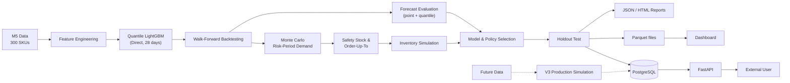

# Probabilistic Demand Forecasting for Inventory Decisions: A Walmart M5 Case Study

> **Core Business Questions**
>
> * How well can we forecast not just the expected 28-day demand, but the full **range of likely demand**, for 300 SKUs with very different volume and intermittency patterns?
> * How can a probabilistic forecast be turned into safety-stock and order-up-to levels that hit a target service level?
> * Does modelling uncertainty directly lead to lower inventory cost than adding an error buffer to a point forecast?

This project uses Walmart's **M5 Forecasting** dataset (store `CA_1`) to build a probabilistic forecasting and replenishment pipeline. A LightGBM model produces **quantile forecasts** for each SKU and day. Those daily quantiles are combined by **Monte Carlo simulation** into a distribution of demand over the replenishment risk period, and the safety stock is read directly from that distribution at the target service level.

The system covers centralized feature engineering, direct multi-horizon quantile forecasting, walk-forward validation, simulation-based safety stock, a periodic-review inventory simulation, PostgreSQL persistence, and FastAPI serving.

Dashboard: https://demand-forecast-inventory.streamlit.app/

---

## Why Probabilistic?

Inventory decisions are made on the **tail of demand**, not its average. A point forecast says "we expect 3 units"; a replenishment decision has to answer "how much stock do we need so that we run out on fewer than X% of cycles?"

The earlier version of this project (v1) answered that with a point forecast plus a safety stock scaled by historical RMSE. That approach assumes forecast errors are roughly symmetric and similar across SKUs, which does not hold for a retail portfolio where many items sell zero on most days and occasionally spike.

The current version (v2) forecasts the demand distribution directly:

| | v1: Point + RMSE | v2: Probabilistic |
|---|---|---|
| Model output | One value per SKU-day | A set of quantiles per SKU-day |
| Uncertainty | Historical RMSE, symmetric | Learned per SKU, day and context; asymmetric |
| Intermittent SKUs | Normal-style buffer, often too large | Distribution can be skewed and bounded at zero |
| Risk-period demand | Sum of point forecasts + buffer | Simulated distribution of total demand |
| Safety stock | z × RMSE-based term | Quantile of simulated demand − expected demand |

---

## Dataset Scope

* **300 curated SKUs** from the `FOODS`, `HOBBIES`, and `HOUSEHOLD` departments.
* SKUs are stratified by revenue and sales frequency, so the set includes fast movers, slow movers and highly intermittent items.
* All 300 SKUs have a complete three-year history and continue into the evaluation period. The current model is trained on the **most recent 1 year**.
* The full-history design avoids missing-SKU issues in out-of-sample forecast and inventory evaluation.

**Current limitation:** cold starts, partial histories, product launches and exits are not yet evaluated. The remaining future data is reserved for the v3 production-style simulation.

---

## Architecture



---

## Forecasting Pipeline

### Centralized feature engineering

All model features are created through a central feature-engineering class before training:

* Demand lags (computed strictly from t-1 and earlier to avoid leakage)
* Rolling statistics
* Calendar variables
* Events and SNAP indicators
* Price information
* Trend features
* SKU-level information

Features at a forecast origin use only information available at that origin.

### Direct multi-horizon quantile LightGBM

The model is trained across the full 28-day horizon so that each future day is predicted without feeding earlier predictions back in as features. Origin dates are created with a 7-day stride to keep training size manageable.

For every SKU and forecast day the model outputs:

* a **point forecast** (`sales_pred`), used as the expected demand, and
* a grid of **quantile forecasts** (`q<level>` columns), trained with the quantile (pinball) loss, which describe the shape of the demand distribution for that day.

A recursive LightGBM variant (one-step-ahead, predictions fed back as lags) is also implemented and compared in backtesting.

### Operational baselines

* Seasonal naive
* Simple moving average
* Seasonal moving average (a stronger baseline)
* Croston & Croston SBA (included for the intermittent SKUs; they performed worst overall because their parameters are dominated by the smoother SKUs)

Baselines go through the same inventory simulation, so the comparison covers both accuracy and cost.

---

## From Daily Quantiles to Safety Stock

A replenishment order placed at a review date has to cover demand over the **risk period**: lead time + review period (L + R = 4 + 7 = 11 days). The model gives quantiles for each **single day**, but the decision needs a quantile of the **total** demand over 11 days.

Those are not the same thing. Adding up the daily 85th percentiles gives a number far above the 85th percentile of the 11-day total, because it assumes every day is a high-demand day at once. This was the main cause of inflated safety stock in earlier experiments.

The pipeline solves this by **Monte Carlo simulation** of the risk-period demand, for each SKU:

1. **Take the daily quantile forecasts** for the first L + R days of the horizon.
2. **Build each day's demand distribution** by linear interpolation between the quantile levels (an approximate inverse CDF).
3. **Simulate 5,000 demand paths:** for each path and day, draw u ~ Uniform(0, 1), map it to a demand value through that day's inverse CDF, and clip at zero.
4. **Sum each path over the risk period** to get 5,000 samples of total risk-period demand.
5. **Read the order-up-to target** as the quantile of those samples at the target service level τ:

$$
S = Q_{\tau}\left(\sum_{t=1}^{L+R} D_t\right)
$$

6. **Safety stock** is the gap between that target and the expected demand from the point forecast:

$$
SS = \max\left(0,\; S - \sum_{t=1}^{L+R} \hat{y}_t\right)
$$

```text
Daily quantile forecasts (q-levels × L+R days)
        ↓  interpolate → per-day inverse CDF
Monte Carlo: 5,000 demand paths
        ↓  sum over L+R days
Distribution of risk-period demand
        ↓  τ-quantile
Order-up-to target S
        ↓  minus expected demand
Safety stock
```

**Modelling assumptions**

* **Daily demands are sampled independently.** Real demand is often positively autocorrelated (a busy day tends to be followed by another), which would widen the true distribution of the total. The simulation may therefore slightly understate risk for such SKUs.
* **Tails are bounded by the outermost quantiles.** Interpolation does not extrapolate beyond the lowest and highest quantile levels the model predicts, so extreme spikes are capped at the top quantile.
* **Fixed random seed** (42) for reproducible safety-stock levels across runs.
* If no quantile columns are present, the policy raises no buffer (SS = 0); the RMSE policy should be used for point-only models.

### Cost-aligned service level

With holding cost h = 0.2 and stockout cost p = 1.0 per unit, the cost-optimal (newsvendor) service level is:

$$
\tau^* = \frac{p}{p + h} = \frac{1}{1.2} \approx 83.3\%
$$

This is the reference for choosing `target_service_level`.

### Safety-stock policies compared

| Policy | Description |
|---|---|
| `rmse` (v1) | Point forecast + buffer scaled by historical forecast RMSE |
| `quantile` (v2, selected) | Monte Carlo risk-period distribution from quantile forecasts (above) |
| `coverage` (v2) | Safety stock calibrated using the **empirical coverage** of the forecast quantiles on historical data |

---

## Validation & Model Selection

The pipeline uses **chronological walk-forward backtesting**, not random splits:

1. **Model experimentation** — compare forecasting approaches and safety-stock policies across historical windows.
2. **Model selection** — choose a candidate model + policy from those results.
3. **Holdout evaluation** — evaluate the candidate on unseen data against the same baselines.
4. **Deployment decision** — decide whether the evidence justifies deployment.

Winning backtests does not automatically mean deployment; the holdout and the comparison with strong baselines are separate checks.

---

## Evaluation

### Point-forecast accuracy

* **WRMSSE** — primary accuracy metric
* **WAPE** — volume-weighted absolute error
* **MAE** — interpretable absolute error
* **Bias** — systematic over- or under-forecasting
* **Cumulative MAE and bias** — over the risk period
* **Forecast Value Added (FVA)** — relative to baselines

### Probabilistic quality

* **Empirical coverage** — share of actual demand falling at or below each predicted quantile; a well-calibrated q85 should cover about 85% of outcomes.

### Inventory performance

Periodic-review, order-up-to simulation with fixed parameters:

* Lead time **4 days**, review period **7 days**
* Holding cost **0.2** per unit, stockout cost **1.0** per unit
* Lost sales (unmet demand is not backordered)
* Outputs: holding cost, stockout cost, total cost, lost sales

---

## Holdout Test Result

The selected candidate was evaluated on a separate, unseen holdout period (1 window).

**Current deployment candidate: Quantile LightGBM Direct (1-year training) + `quantile` safety-stock policy**

### Baseline choice

All results are compared against one fixed baseline: **Simple Moving Average (SMA) with the `rmse` safety-stock policy.**

* SMA produces no quantiles, so running it through a probabilistic policy would mean imposing an assumed distribution on it. That would test the assumption, not the forecast.
* SMA + `rmse` is also SMA's **lowest-cost** configuration in the holdout ($17,615.54, versus $17,758.96 under `coverage`). Using a baseline at its best is the stricter test.
* The probabilistic policies are applied only to LightGBM, which produces real quantile forecasts.

### Forecast accuracy

Point-forecast metrics come from the same model and are identical under every safety-stock policy. Model training differs slightly between v1 and v2, so both are shown.

| Metric | SMA (baseline) | LGBM v1 (point) | LGBM v2 (quantile model) | v2 vs SMA |
|---|---:|---:|---:|---:|
| WRMSSE | 0.9378 | 0.8435 | **0.8349** | 11.0% lower |
| WAPE | 0.8483 | 0.7889 | **0.7852** | 7.4% lower |
| MAE | 1.1700 | 1.0880 | **1.0830** | 7.4% lower |
| BIAS% | 0.01% | -2.61% | -2.59% | — |
| Cumulative MAE | 5.8985 | 5.4316 | **5.3991** | 8.5% lower |
| Cumulative bias | 0.0012 | -0.3360 | -0.3333 | — |

### Inventory cost and FVA (baseline: SMA + `rmse`)

| Model | Safety-stock policy | Holding cost | Stockout cost | Total cost | Savings vs baseline | Cost FVA |
|---|---|---:|---:|---:|---:|---:|
| SMA (baseline) | `rmse` | $16,493.31 | $1,122.23 | $17,615.54 | — | — |
| LGBM Direct (v1) | `rmse` | $15,251.41 | $1,227.88 | $16,479.29 | $1,136.25 | 6.45% |
| LGBM Direct | `coverage` | $15,208.70 | $1,441.62 | $16,650.32 | $965.22 | 5.48% |
| **LGBM Direct** | **`quantile`** | **$14,428.34** | $1,490.09 | **$15,918.42** | **$1,697.12** | **9.63%** |

### Business impact

* **The probabilistic setup gives the largest saving:** 9.63% ($1,697) below the SMA baseline, against 6.45% for the v1 point forecast with RMSE safety stock.
* **Moving from RMSE to quantile safety stock is worth $561 (3.4%)** on the same LightGBM model. Almost all of the gain comes from lower holding cost (−$823), at the price of slightly higher stockout cost (+$262). Each unit of holding avoided saves more than the extra stockouts cost, which is what the newsvendor ratio predicts at a ≈83% target.
* **Coverage calibration did not pay off.** Versus the `quantile` policy it added ~$780 in holding cost to avoid ~$48 in stockouts, and it came out behind even the v1 RMSE policy. Better-calibrated intervals are not automatically cost-optimal.
* **Holding cost still dominates** (~91% of total for the quantile policy, 92.5% for v1, 93.6% for the baseline). Sparse long-tail SKUs remain over-stocked by every approach.

The holdout is a single window. It is the current evidence for the deployment decision, not a guarantee of production performance.

---

## Inventory Simulation

At each review date:

```text
Quantile forecasts
   ↓
Monte Carlo risk-period demand (L + R)
   ↓
Order-up-to target S at service level τ
   ↓
Safety stock = S − expected demand
   ↓
Order quantity = S − inventory position
```

The current test simulation generates decisions for the whole evaluation month at each review period and records realized outcomes.

The v3 production-style simulation will run sequentially:

```text
Review date
    ↓
Generate quantile forecast
    ↓
Simulate risk-period demand → order
    ↓
Store decision in PostgreSQL
    ↓
Demand occurs
    ↓
Actual sales / lost sales become available
    ↓
Update realized inventory outcomes
    ↓
Next review period
```

---

## Database & API

**PostgreSQL** stores:

* Point and quantile forecasts
* Inventory decisions and state
* Replenishment quantities
* Safety-stock levels
* Realized inventory costs (filled in after the demand period has passed)

### FastAPI serving

```http
GET /forecast
```

Returns pre-computed results for a requested `store_id` and `item_id`:

* 28-day point forecasts and prediction dates
* Quantile forecasts
* Safety stock
* Order-up-to level

The API is a read-only layer over database snapshots written by the offline forecasting and inventory jobs. The Streamlit dashboard reads local Parquet exports directly.

---

## Diagnostic Findings

* **Daily quantiles must not be summed.** Summing daily quantiles overstates risk-period demand; simulating the total is what made quantile-based safety stock usable.
* **Probabilistic beats point + RMSE:** 9.63% vs 6.45% cost FVA over the SMA baseline (3.4% lower cost on the same model), because uncertainty is learned per SKU and context instead of applied as one symmetric buffer.
* **Calibration is not the same as cost-optimality.** Better coverage increased LGBM's cost; the service level should follow the cost ratio (≈83%).
* **Holding cost dominates** (~91–94% across all configurations), driven by over-stocking long-tail intermittent SKUs.

---

## Roadmap

* **Correlated demand paths:** sample days jointly (e.g. a shared demand shock per path, or a copula) instead of independently, so autocorrelated SKUs get realistic risk-period variance.
* **Direct risk-horizon quantiles:** forecast the L + R total directly with quantile regression as an alternative to aggregating daily quantiles, and compare.
* **Probabilistic scoring:** add pinball loss / CRPS and coverage per quantile and per SKU segment to model selection.
* **Differentiated policies:** segment-specific service levels and methods (e.g. Croston SBA or min-max for slow movers, quantile LightGBM for fast movers).
* **Multi-window holdout** for more robust policy comparisons.
* **Pipeline generalization:** move hardcoded M5 column references into a central schema config.

---

## System Limitations

* **Scale & memory:** direct multi-horizon targets enlarge the dataset per origin, and Monte Carlo runs per SKU. Fine for 300 SKUs; scaling needs vectorized simulation and optimized feature pipelines.
* **Independence assumption** in the risk-period simulation (see above).
* **Scope:** full historical coverage assumed; no cold starts, launches or exits.
* **Single holdout window** for policy comparison.

---

## Running the Pipeline

```bash
cd retail-forecast-system
uv sync
```

### Walk-forward backtest

```bash
uv run python run_pipeline.py \
    --mode backtest \
    --model lgbm \
    --forecast-type direct \
    --backtest-windows 5
```

### Holdout test

```bash
uv run python run_pipeline.py \
    --mode test \
    --model lgbm \
    --forecast-type direct
```

---

## Primary Evaluation Principle

**WRMSSE is the primary point-accuracy metric**, complemented by WAPE, cumulative MAE and bias, FVA, empirical coverage, and inventory cost. The final decision is made on inventory cost, because that is what the forecast is for.

```text
Demand data
    ↓
Feature engineering
    ↓
Quantile forecast
    ↓
Forecast + calibration evaluation
    ↓
Monte Carlo risk-period demand
    ↓
Safety stock & order-up-to level
    ↓
Realized inventory outcomes
```

The goal is not just lower forecast error, but a forecast of uncertainty that leads to better replenishment decisions.